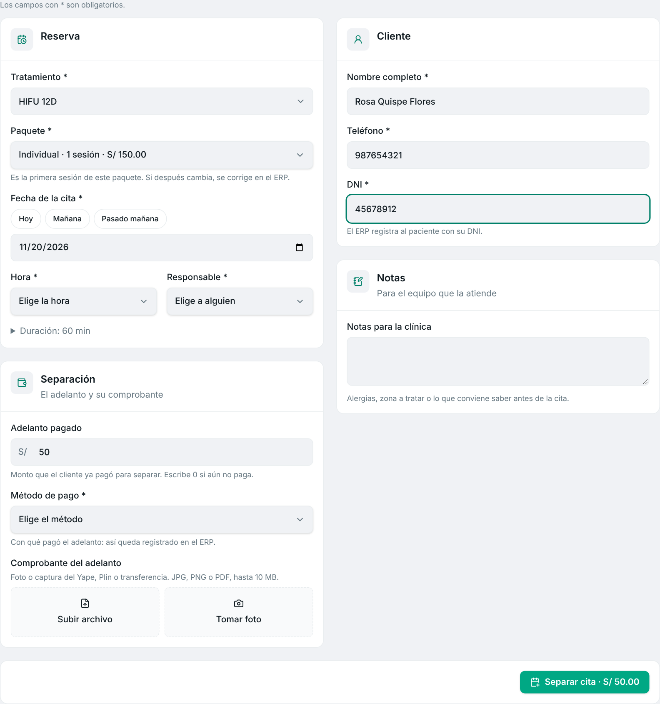
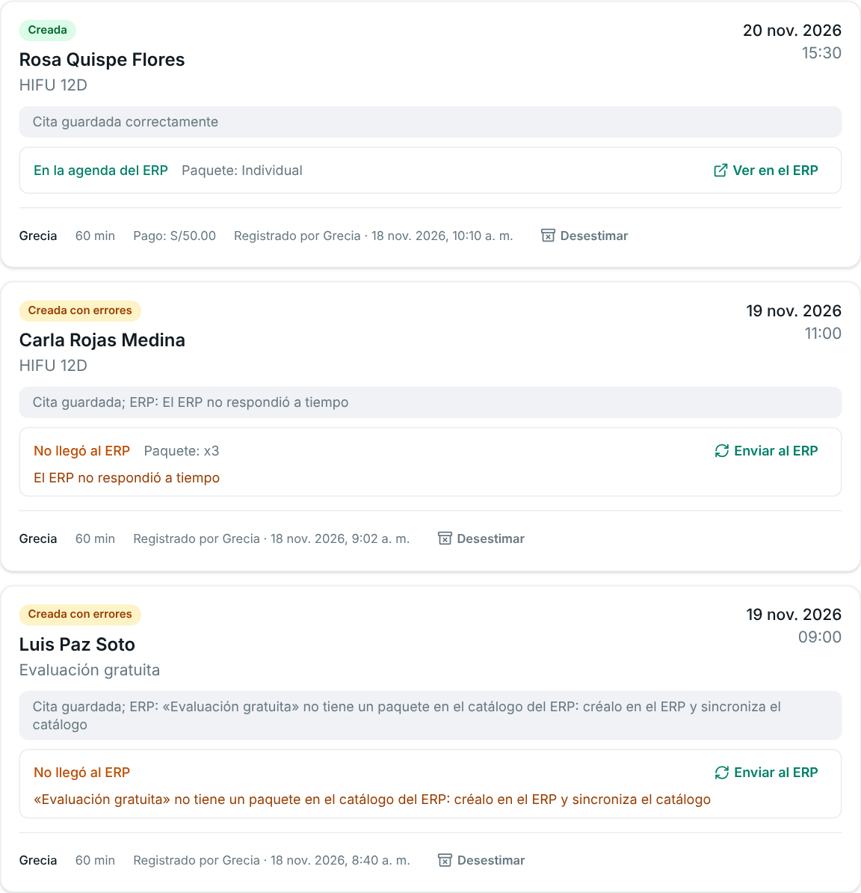
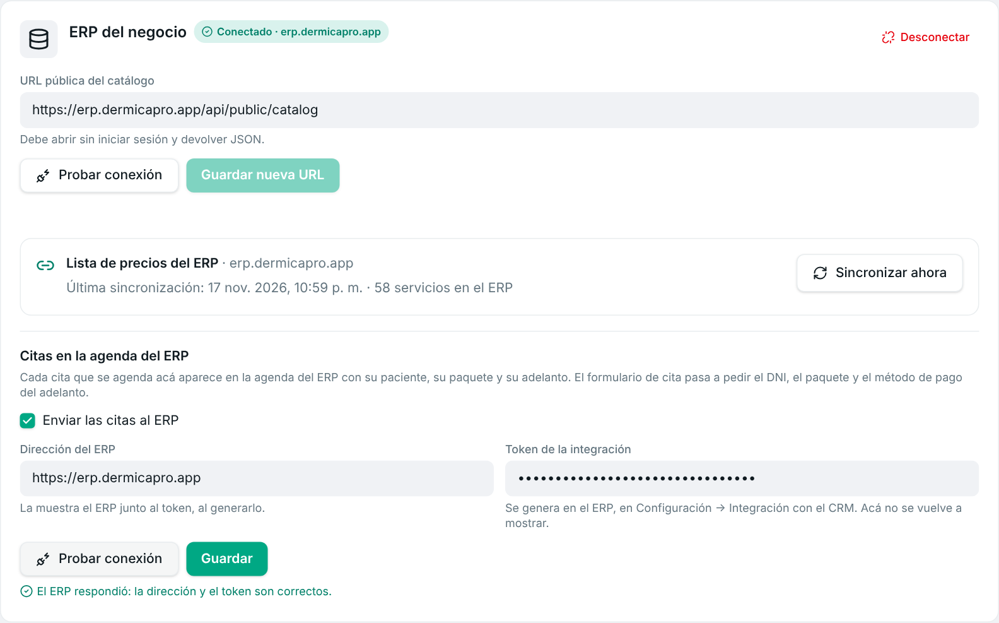

# Citas al ERP: cómo se ve en el CRM

Capturas de la app compilada con el backend simulado y datos de prueba.

## Formulario de cita con el envío activo

Aparecen Paquete (ya elegido el de menos sesiones), DNI y, al escribir un
adelanto, Método de pago.

## Historial de citas

Una cita que ya está en la agenda del ERP, una que no llegó porque el ERP no
respondió y una cuyo tratamiento no está en el catálogo del ERP.

## Integraciones → ERP

La sección nueva, debajo de la lista de precios, tras una prueba de conexión
exitosa.

